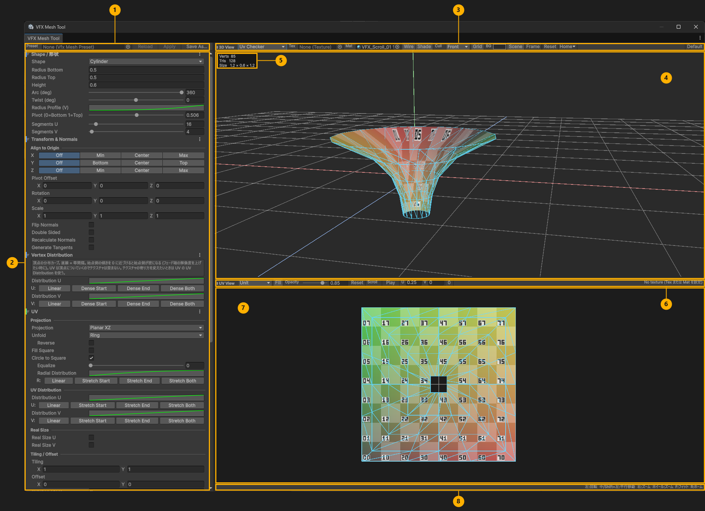
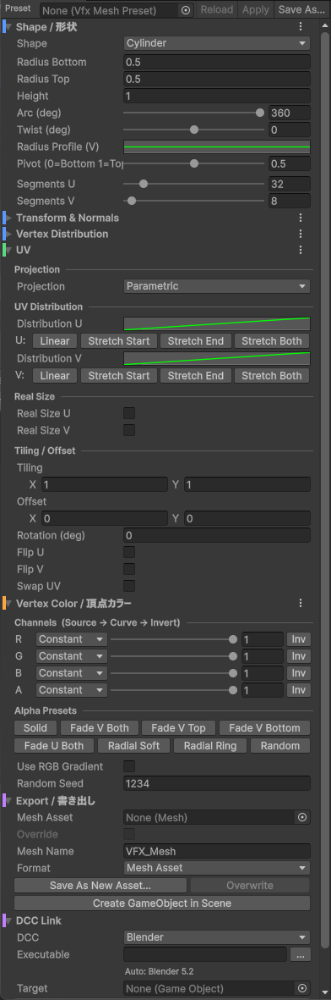
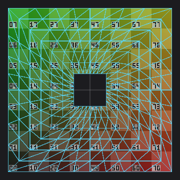
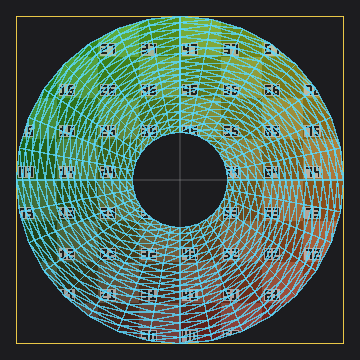
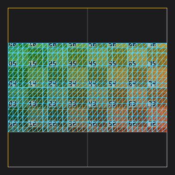

# VFX Mesh Tool (Unity)

[English](README.md) | **日本語**

リアルタイム VFX 向けのメッシュを Unity エディタ内で生成・確認するツール。
筒・円盤・球・回転体・パス掃引などの形状、頂点カラー / アルファのグラデーション、各種 UV 展開、3D と UV のライブプレビュー、OBJ / FBX 書き出し、Blender との往復編集をひとつのウィンドウで扱う。



## 導入

対応: Unity 2021.3 以降、Built-in / URP。

1. `Window > Package Manager` を開く。
2. 左上の `+` > `Add package from git URL...` に次の URL を入れる。

   ```
   https://github.com/deeee5/VfxMeshTool.git#v0.3.0
   ```

3. `Window > VFX Mesh Tool` で開く。

- `#v0.3.0` を外すと main の最新が入る。`Packages/manifest.json` に `"com.deeee5.vfxmeshtool": "https://github.com/deeee5/VfxMeshTool.git#v0.3.0"` と書いてもよい。
- 依存パッケージの FBX Exporter (`com.unity.formats.fbx` 5.1.6) は自動で入る。
- 手元で改造するときは、clone したフォルダを `Add package from disk...` で `package.json` を選んで追加する。`Assets/` 配下にフォルダごと置いた場合は FBX Exporter が自動では入らないので、Package Manager から追加する (無くても FBX 書き出し以外は動く)。
- プレビュー用シェーダーは Unlit の CG。HDRP ではプレビューが出ない可能性がある (UserMaterial モードは HDRP のマテリアルで動く)。

## 画面構成

| 番号 | 名前 | 内容 |
| --- | --- | --- |
| ① | プリセットバー | 設定一式の保存・読み込み (`VfxMeshPreset` アセット)。Save As / Apply / Reload |
| ② | メッシュ設定パネル | 形状・Transform・頂点分布・UV・頂点カラー・書き出し・DCC 連携の設定項目。ここの変更がメッシュと書き出し結果に反映される (Undo 対応) |
| ③ | 3D ビューツールバー | 3D プレビューの表示設定。表示モード・プレビュー用テクスチャ / マテリアル・ワイヤーフレーム・陰影・カリング・グリッド・背景色・Scene ビュー表示・カメラ (Frame / Reset / Home)・表示設定の初期化 (Default) |
| ④ | 3D プレビュー | 生成したメッシュの立体表示。マウスでカメラ操作 |
| ⑤ | メッシュ情報 | 頂点数・三角形数・サイズ (幅 × 高さ × 奥行き) |
| ⑥ | UV ビューツールバー | UV プレビューの表示設定。表示範囲・塗りつぶし・不透明度・表示位置のリセット・UV スクロール再生 |
| ⑦ | UV プレビュー | UV 展開図。背景にテクスチャ、上にメッシュのワイヤーフレームと塗りつぶし |
| ⑧ | ステータスバー | 操作ガイドとエラー表示 |

- ③⑥ のツールバーの項目は表示専用。メッシュの形も書き出す値も変わらない。
- ②と④⑦の境界、④と⑦の境界はドラッグで動かせる。ウィンドウが狭いとツールバーは 2 段に折り返す。

### メッシュ設定パネル (②) のセクション

セクション見出しの左端の色帯が、そのセクションが変えるものを表す。

| 色 | セクション | 内容 |
| --- | --- | --- |
| 青 | Shape / 形状 | 形状の種類とその寸法・分割数 |
| 青 | Transform & Normals | 原点合わせ (Align to Origin)・Pivot Offset・回転・拡大・法線の向き・両面化 |
| 青 | Vertex Distribution | 頂点の並び方の分布カーブ |
| 緑 | UV | UV の展開方法・UV だけの分布・実寸 UV・タイリング / オフセット |
| 橙 | Vertex Color / 頂点カラー | 頂点カラー R / G / B / A の値とグラデーション |
| 紫 | Export / 書き出し | メッシュアセット・OBJ・FBX への保存とシーン配置 |
| 紫 | DCC Link | Blender などの DCC ツールでの編集と Unity への戻し |

各セクション見出し右端の ⋮ メニュー > `Reset to Default` で、そのセクションだけ初期値に戻せる (Shape は形状の種類を残してパラメータだけ戻す。Undo できる)。



### 3D ビューツールバー (③)

| 項目 | 内容 |
| --- | --- |
| 表示モード | Textured (テクスチャ × 頂点カラー) / TexturedAdditive (加算) / VertexRGB / VertexAlpha / UvChecker (チェッカー + UV を色で表示) / Normals / UserMaterial (Mat に入れた自分のマテリアル) |
| Tex / Mat | プレビュー用のテクスチャとマテリアル。Tex が空なら Mat の `_MainTex` / `_BaseMap` を使う |
| Wire / Shade / Grid | ワイヤーフレーム・視線方向の陰影・床のグリッド |
| Cull | 描画しない面。Off = 両面、Back = 裏面を消す、Front = 表面を消して内側だけ見る |
| BG | 背景色 |
| Scene / Handles | Scene ビューへの生成メッシュの表示 / Path の制御点ハンドル (Path の Points のときだけ) |
| Frame / Reset / Home | メッシュ全体が収まる位置へ寄せる (F キー) / ホーム位置に戻す (R キー) / ホーム位置の登録と初期化 |
| Default | 表示の設定の初期化 (背景色・表示モード・UV ビュー・スクロール・3D / UV の分割比・カメラ)。Tex / Mat とメッシュの設定はそのまま |

### UV ビューツールバー (⑥)

| 項目 | 内容 |
| --- | --- |
| 表示範囲 | Unit = 0..1、Extended = -1..2 |
| Fill / Opacity | 3D と同じ表示モードでのメッシュの塗りつぶしとその不透明度 (頂点アルファがテクスチャのどこに乗るかの確認用) |
| Reset | UV ビューの表示位置のリセット |
| Scroll | テクスチャを流したときの見え方の確認。Play で再生、U / V が毎秒のスクロール量、0 で先頭へ。表示だけでメッシュの UV は変わらない (UserMaterial モードでは効かない) |

### カメラ操作 (④⑦)

| 操作 | 動作 |
| --- | --- |
| 左ドラッグ / Alt+左ドラッグ | 回転 |
| 中ドラッグ / Shift+左ドラッグ | 平行移動 |
| 右ドラッグ / ホイール | ズーム |
| `F` | メッシュ全体が収まる位置へ寄せる |
| `R` | ホーム位置に戻す |

- カメラはワールド座標で固定。メッシュのサイズに追従しないので、形状を大きくすればそのぶん大きく見える (実寸の変化がそのまま見える)。床のグリッドの間隔もカメラ距離だけで決まる。
- UV プレビューはドラッグで平行移動、ホイールでズーム、UV ビューツールバーの Reset で元に戻る。背景のテクスチャはラップモード (Repeat / Clamp) がそのまま反映される。

## 形状 (Shape)

すべて (u, v) ∈ [0,1]² のパラメトリック曲面。U = 周囲・幅方向、V = 高さ・長さ・半径方向。

| Shape | 主なパラメータ | 用途例 |
| --- | --- | --- |
| Plane | 幅 / 長さ / 向き / Bend / Width Profile | 板ポリ、テーパー付きトレイル、曲面シート |
| Cylinder | 上下半径 / 高さ / Arc / Twist / Radius Profile / Pivot | 筒、コーン (上半径 0)、オーラ、竜巻 |
| Sphere | 半径 / 緯度範囲 / Arc | 球、半球ドーム、シールド |
| Disc | 内外半径 / Arc / Height / Height Profile / UV Mode | 円盤、リング、扇形スラッシュ、ショックウェーブ |
| Torus | 大半径 / 管半径 / Arc / Tube Arc / Tube Start | リング状の衝撃波、輪 |
| Cross | 板の枚数 / 幅 / 高さ / Alternate Flip U | 交差板 (ビルボード代わりの火柱など) |
| Revolve | プロファイル点列 (半径, 高さ) / Smooth / Top Cap Curvature / Arc / Twist | 任意の回転体 (ベル、しずく、花瓶型など) |
| Path | Path Source (Points / Curve / Coil) / 断面 (Ribbon / Tube / Cross / Profile) / Scale・Scale Y・Twist Profile / Up Mode | スプライン掃引 (トレイル、螺旋、ソウラーコースター) |
| Imported | Source Mesh / Keep Original Colors | 既存のメッシュ (.asset・FBX 内のメッシュなど) の形をそのまま使い、UV・頂点カラー・Transform・法線だけをかける |

### Revolve / Path の補足

- Revolve のプロファイルは最初の点が下端 (V=0)。Smooth は Catmull-Rom 補間。
- `Top Cap Curvature`: 上端の蓋の丸み。0 = 円錐状に尖る、1 = 球の極のような丸い蓋。上端が軸上 (半径 0) で閉じるプロファイル向けで、Smooth が ON のときだけ効く。
- プロファイルと制御点のリストは、行ごとの `+` (直後に中点を挿入) と `-` (削除) で編集する。点は最低 2 個に保たれる。

| Path Source | 内容 |
| --- | --- |
| Points | 制御点の並び。Scene ビューのハンドルでドラッグ編集できる (3D ビューツールバーの `Handles`) |
| Curve | X 方向の直線を 2 本のカーブ (Offset Y / Offset Z、単位はメートル) で曲げたパス。波打つトレイル向け |
| Coil | 螺旋。Turns / Height / Radius と、巻きの太さ (Radius Profile)・詰まり方 (Height Profile) のカーブ |

- `Scale (V)` は断面全体、`Scale Y (V)` は縦方向だけの倍率。`Twist Profile (V)` はねじれの配分。各カーブの下にプリセットボタンがある。
- 断面 `Cross` は直交する 2 枚の帯 (UV 共通)、`Profile` は任意の 2D 断面。
- `Up Mode` は断面の上方向の決め方。基本は `RotationMinimizing` (ねじれ最小)。
- Path の V は弧長で正規化される。距離に応じたタイリングは UV の Tiling で行う。

## Transform & Normals

- `Align to Origin`: 軸ごとの Off / Min / Center / Max (Y は Bottom / Top) のボタン。メッシュの端または中央を原点 (0) に合わせる。回転・拡大後の向きで合わせ、形を変えても合わせたまま。
- `Pivot Offset`: 原点合わせの後に足す移動量 (例: 下端を 0 にしてから 0.1 上げる)。
- Cylinder の `Pivot (0=Bottom 1=Top)` は筒の高さ方向の基準点。原点合わせがその方向を揃えているときは効かないので、グレー表示の `Pivot (Align 優先)` になる。
- `Flip Normals` / `Double Sided` / `Recalculate Normals` / `Generate Tangents`: 表裏の反転 / 頂点を複製した両面化 / Unity の法線再計算 / ノーマルマップ用の接線。

## Vertex Distribution (頂点分布)

`Distribution U / V`: 頂点の並び方のカーブ。直線 = 等間隔。フェード端だけ細かく割りたいときに使う。UV は頂点についていくのでテクスチャは歪まない (テクスチャの寄り方を変えるのは UV セクションの UV Distribution)。

## UV

UV セクションは上から順に処理される: Projection → UV Distribution → Real Size → Tiling / Offset。

### Projection (展開方法)

| Projection | U | V | 用途 |
| --- | --- | --- | --- |
| Parametric | 形状固有 (周囲・幅) | 形状固有 (高さ・長さ・半径) | 既定。Disc は `UV Mode` で Radial / Planar を選べる |
| Planar XY / XZ / YZ | X / X / Z | Y / Z / Y | 正面・真上・側面からの投影。バウンディングボックス中央が (0.5, 0.5) |
| Cylindrical | Y 軸まわりの角度 | 高さ | 回転体に筒状にテクスチャを巻く |
| Spherical | 経度 | 緯度 (原点中心) | ドームやベルに球状に貼る |
| Polar | Y 軸まわりの角度 | 軸からの距離 | 上から見たリング状 (ショックウェーブ系のテクスチャ) |

- 投影は Transform 適用前の形状で計算する (Rotation で向きを変えても UV はついてくる)。
- 角度を使う投影は継ぎ目で UV が裂けない (U が 1 周ぶんずれることがある)。
- Parametric 以外では頂点カラーの `U` / `V` / `RadialUV` ソースも投影後の値を使う。

### Planar のオプション

| オプション | 内容 |
| --- | --- |
| Unfold | 投影で重なる面の広げ方。Center = 中心から面に沿って外へ (ドーム・ベル・花瓶・円盤向き) / Ring = 奥の端が内側・手前の端が外側の指輪状 (筒向き、くびれのある筒でも重ならない) / Cut = 継ぎ目で切った長方形 (帯状のテクスチャ向き)。`Reverse` で起点を反対側に |
| Fill Square | 縦横それぞれをいっぱいに伸ばした 0..1 の正方形 (縦横比は崩れる) |
| Circle to Square | 中心から見た向きはそのまま、距離を正方形の縁まで伸ばす変換。同心円が同心の正方形になり、四隅まで使える |
| Equalize | Circle to Square での各マスの UV の大きさのそろえ具合。0 = そのまま、1 = 同じ面積 (中心の穴と外周は動かない) |
| Radial Distribution | Circle to Square での中心から外周へのリングの間隔のカーブ |

| Circle to Square | Unfold: Ring | Unfold: Cut |
| --- | --- | --- |
|  |  |  |

- 重なりの解消の目安 (UV の重なり面積): 花瓶を上から (Center) 53.6% → 0%、球の 3/4 を上から (Center) 75% → 0%、くびれのある筒を上から (Ring / Cut) 100% → 0%。
- 投影の軸を横切る形 (横から見た筒) はどのモードでも分けきれない。その場合は Cylindrical を使う。
- 平らな形では Unfold を使っても普通の Planar と同じ結果になる。
- 組み合わせの順番: Unfold → Fill Square → Circle to Square。

### UV Distribution

`Distribution U / V`: UV だけの分布カーブ。頂点は動かさず、テクスチャの寄り方を変える (例: `Stretch Start` で始点側を引き伸ばす)。頂点ごとに評価するので、細かいカーブには Segments を増やす。頂点カラーには影響しない。

### Real Size

`Real Size U / V`: 0..1 ではなく実際の長さでの UV の割り当て (1 タイル = `Tile Size (m)`、`Scale` で U / V ごとの倍率)。長さは面積加重の平均で、Transform の Scale も含む。両方 ON でテクスチャの縦横比が保たれる。

### Tiling / Offset

`Tiling` / `Offset` / `Rotation (deg)` / `Flip U` / `Flip V` / `Swap UV`: 最後にかかる UV の後処理。

## Vertex Color (頂点カラー)

| 項目 | 内容 |
| --- | --- |
| R / G / B / A | チャンネルごとの値の元 (Source)・リマップのカーブ (Curve)・反転 (Inv) |
| Source | Constant / U / V / RadialUV (UV 中心からの距離) / PositionX・Y・Z (バウンディングボックス内で正規化) / Random (頂点ごとの決定的乱数) |
| Alpha Presets | A チャンネルの典型的なフェード (両端・上・下・放射状など) のワンクリック設定 |
| Use RGB Gradient | RGB の Gradient での上書き (A はチャンネル設定のまま) |

## Export (書き出し)

| Format | 拡張子 | 面 | 頂点カラー | 用途 |
| --- | --- | --- | --- | --- |
| MeshAsset | .asset | 三角形 | RGBA | Unity 内でそのまま使う。Override が ON なら上書き・Auto Write |
| Obj | .obj | 四角形 | RGB のみ | Blender などでの編集 |
| Fbx | .fbx (バイナリ) | 三角形 | RGBA | 頂点アルファを保った DCC への受け渡し |

| ボタン / 項目 | 内容 |
| --- | --- |
| Mesh Asset | 編集のベースにするメッシュ。入れると読み込む。このツールで保存したメッシュなら作ったときの設定が戻り、それ以外は Imported 形状になって読み込んだ直後は元と同じ見た目 (元の UV・頂点カラーのまま) |
| Override | OFF (既定): Mesh Asset には書き込まない。結果は Save As New Asset で別のアセットとして保存する。ON: Overwrite と Auto Write で Mesh Asset に上書きする。上書きできる .asset のときだけ (FBX 内のメッシュなどは不可)。新しいメッシュを読み込むたびに OFF に戻る |
| Auto Write | Override が ON のとき、変更のたびの Mesh Asset への書き込み (シーンのオブジェクトに即反映)。メッシュを読み込んだ直後・ON にした直後・ウィンドウを開いた直後は書き込まない |
| Save As New Asset... | 結果の新しい `.asset` としての保存。保存したアセットが Mesh Asset 欄に入る (元のアセットはそのまま) |
| Overwrite | Override が ON のとき、Mesh Asset の中身の差し替えと保存 (参照しているシーンのオブジェクトも更新される) |
| Export OBJ... / Export FBX... | プロジェクト外にも保存できる OBJ / FBX の書き出し |
| Create GameObject in Scene | MeshFilter + MeshRenderer を持つ GameObject の作成 (Mat があれば割り当て) |

- このツールで保存した .asset には、作ったときの設定が隠しサブアセットとして入る (Mesh Asset 欄に入れたときに戻すため)。
- Imported のメッシュを元のアセット自身に上書きするときは、最初の上書きで元の形の複製をアセット内に残し、以後はそれを元に作る (回転などが重ねがけにならない)。
- OBJ / FBX は右手系に変換して書き出すので、Blender の標準インポーターで向き・大きさが合う。
- OBJ は同じ曲面の中で位置と頂点カラーが同じ頂点を結合する (筒の継ぎ目・円錐の先端など)。UV の継ぎ目は残る。頂点カラーは `v x y z r g b` 形式 (Blender 4.1 / 5.2 で確認)。
- FBX は Unity FBX Exporter で書き出す。単位が cm なので、Blender ではオブジェクトのスケールが 0.01 になる (見た目の大きさは正しい。編集前に `Ctrl+A > Scale` で適用すると扱いやすい)。

## DCC Link (Blender などで編集して戻す)

| 項目 | 内容 |
| --- | --- |
| DCC | Blender (書き出し → 起動 → 読み込み → 送り返しを自動) / Custom (それ以外のアプリケーション。書き出し → 起動) |
| Application | 起動するアプリケーション。Blender は自動検出 (`Blender 5.2/blender.exe (自動検出)` のように表示)。**Use Other...** で別のもの (別バージョンの Blender、Custom なら任意のアプリ) を選び、**Auto** で自動検出に戻す。Custom で選んだアプリが Blender なら、読み込み・送り返しの自動化も使われる |
| Send Format | 起動の前に今の設定を書き出す形式。Obj (四角形。Blender ではアルファ付きの頂点カラーも付け直す) / Fbx (三角形、頂点カラー RGBA。Blender では cm 単位のスケールを焼き込んでオブジェクトのスケールを 1 にする) |
| Arguments | Blender 以外の Custom アプリの起動引数 (`{file}` = 送ったファイル、`{return}` = 戻し先) |
| Target | 戻ってきたメッシュで差し替えるシーンのオブジェクト。空なら戻ってきたときにシーンに作る |
| Edit in Blender / Open in DCC | 今の設定を Send Format で書き出し → アプリケーションを起動 (Blender なら → 読み込み) |
| Resume | 前回の .blend を開いて Blender での編集を続けるボタン (前回の編集があるときだけ) |
| Return | DCC から書き出す戻し先のパス (Copy で絶対パスをコピー) |

1. Target を選んで `Edit in Blender` を押す。今の設定が OBJ か FBX (Send Format) で書き出され、Blender が起動してそのファイルを読み込む (頂点アルファも含む)。
2. Blender で編集し、3D ビューのサイドバー (N) > `VFX Mesh` タブの `Send to Unity` を押す。`Send on Save` が ON なら保存 (Ctrl+S) のたびに送る。モディファイアとオブジェクトの Transform は焼き込まれる。
3. Unity が戻りフォルダを監視していて、フォーカスが無くても取り込み、Target のメッシュを差し替える (Undo できる)。

- Blender 以外の Custom アプリの場合は `Return` のパスに FBX を書き出せば同じように取り込まれる。
- 送信フォルダ: `<プロジェクト>/VfxMeshBridge/` (Assets の外)。戻りフォルダ: `Assets/VfxMeshBridge/<Mesh Name>.fbx`。
- 一度 Blender で編集したメッシュはパラメータで作った形ではなくなる。続きは `Resume` で開く (`Edit in Blender` は今のパラメータで送り直すので、Blender での編集は破棄される)。
- DCC の設定はマシンごと (EditorPrefs) に保存される。Blender 側のスクリプトは `Editor/DccAdapters/vfxmesh_blender_bridge.py`。

## ランタイム利用

`VfxMeshTool.Runtime` アセンブリだけでメッシュ生成できる。

```csharp
var settings = new VfxMeshSettings { shape = VfxShapeType.Cylinder, cylinderRadiusTop = 0f };
Mesh mesh = VfxMeshBuilder.Build(settings);
```

## 自動化 API (テスト / バッチ用)

`VfxMeshToolWindow` は GUI なしでもプレビューを画像化できる。

```csharp
var window = ScriptableObject.CreateInstance<VfxMeshToolWindow>();
window.SetSettings(settings);
window.SetPreviewOptions(VfxMeshToolWindow.PreviewMode.Textured, texture, null, wire: true, grid: true, VfxMeshToolWindow.UvViewRange.Unit);
Texture2D png3d = window.CaptureStatic3D(512, 384);
Texture2D pngUv = window.CaptureStaticUv(512, 384);
```

## テスト

`Tests~/` のバッチテスト (`~` 付きのフォルダなので通常はコンパイルされない)。任意のプロジェクトの `Assets/Editor/` にコピーして実行する。

```bash
Unity.exe -batchmode -projectPath <project> -executeMethod VfxMeshToolBatchTest.Run -logFile <project>/unity.log
```

| テスト | 内容 |
| --- | --- |
| VfxMeshToolBatchTest | 全形状の生成・法線・UV・頂点カラー・アセット保存・プレビュー画像 (`<project>/captures/`) |
| VfxUvProjectionTest | UV 投影・Unfold・Circle to Square・UV Distribution・実寸 UV |
| VfxExportTest | OBJ / FBX 書き出し (`<project>/exports/`) |
| VfxResetTest | セクションごとの初期化・表示の Default・原点合わせ |
| VfxImportTest | Mesh Asset 欄 (設定の復元・Imported 形状・FBX 内のメッシュ・Override・元のアセットへの上書き) |
| VfxDccLinkTest | Unity → Blender → Unity の往復 (Blender が必要) |
| VfxTopCapTest | Revolve の Top Cap Curvature |

`VfxMeshToolBatchTestUrp.cs` は URP が入っているプロジェクト用。

## 構成

```
VfxMeshTool/
  package.json, README.md, README.ja.md, CHANGELOG.md, LICENSE.md
  Runtime/
    VfxMeshSettings.cs     … 設定 (形状 / Transform / UV / 頂点カラー)
    VfxMeshData.cs         … 中間データ (頂点・法線・param・uv・色・三角形)
    VfxMeshBuilder.cs      … 形状生成と後処理 (Transform / 両面化 / UV / 頂点カラー)
    VfxMeshPreset.cs       … プリセット (ScriptableObject)
  Editor/
    VfxMeshToolWindow.cs   … メインウィンドウ
    VfxPreviewRenderer.cs  … PreviewRenderUtility のラッパー
    VfxMeshExporter.cs     … アセット保存 / シーン配置
    VfxMeshFileExporter.cs … OBJ / FBX 書き出し
    VfxDccLink.cs          … DCC 連携 (送信・起動・戻りフォルダの監視・差し替え)
    DccAdapters/vfxmesh_blender_bridge.py … Blender 側 (受け取り・Send to Unity・保存時の自動送信)
    VfxMeshPresetEditor.cs
    Shaders/VfxMeshPreview.shader, VfxMeshWire.shader
  Docs~/   … README の画像
  Tests~/  … バッチテスト
```

## 既知の制限

- HDRP では Hidden シェーダーのプレビューが出ない可能性がある (UserMaterial モードは HDRP のマテリアルで動く)。
- 筒の蓋 (キャップ) は未実装。必要なら Disc を組み合わせる。
- UV2 / UV3 へのカスタムデータ書き込みは未実装。

## ライセンス

[MIT](LICENSE.md)。変更履歴は [CHANGELOG](CHANGELOG.md)。
