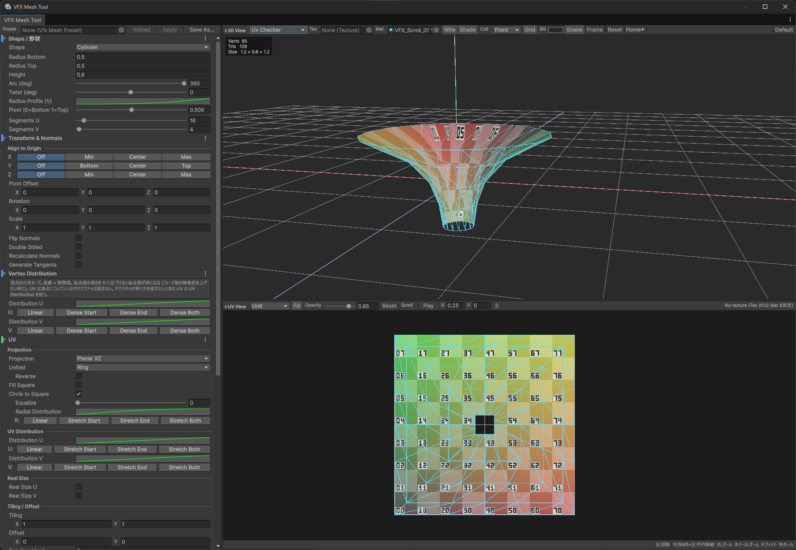
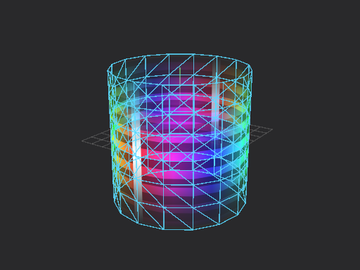

# VFX Mesh Tool (Unity)

リアルタイム VFX 向けのメッシュを Unity エディタ内で生成・確認するツール。
Blender 系の VFX メッシュ生成アドオンにある「複数シェイプ + 頂点アルファ勾配 + UV 確認」を Unity 上で完結させる。

A procedural mesh generator for real-time VFX that runs inside the Unity Editor: cylinders, discs, spheres, revolve and path shapes with vertex colour / alpha gradients, many UV layouts, live 3D and UV previews, OBJ / FBX export and a round trip to Blender.



| UV / Export / DCC Link panel | 3D preview | UV: Circle to Square | UV: Unfold (Ring) |
| --- | --- | --- | --- |
|  |  |  |  |

## Install / 導入

Unity 2021.3 or later. In **Window > Package Manager**, click **+ > Add package from git URL...** and enter:

```
https://github.com/deeee5/VfxMeshTool.git
```

To pin a version, add a tag: `https://github.com/deeee5/VfxMeshTool.git#v0.3.0`. Or add it to `Packages/manifest.json`:

```json
"com.deeee5.vfxmeshtool": "https://github.com/deeee5/VfxMeshTool.git#v0.3.0"
```

Open it from **Window > VFX Mesh Tool**. The documentation below is in Japanese. License: [MIT](LICENSE.md). Changes: [CHANGELOG](CHANGELOG.md).

- Package Manager の `+ > Add package from git URL...` に上の URL を入れる。ローカルで改造するときは、clone したフォルダを `Add package from disk...` で `package.json` を選んで追加する。
- 依存パッケージ `com.unity.formats.fbx` (FBX Exporter 5.1.6) は package.json の dependencies に入っているので、UPM で追加すれば自動で入る。`Assets/` 配下にフォルダごと置いた場合は自動では入らないので、Package Manager から FBX Exporter を追加する (入っていなくても FBX 書き出し以外は動く)。
- Unity 2021.3 以降を想定。Built-in / URP で動作 (プレビューシェーダーは Unlit の CG なので URP では SRPDefaultUnlit パスとして描画される)。
- メニュー `Window > VFX Mesh Tool` で開く。

## 画面構成

| 領域 | 内容 |
| --- | --- |
| 左 | メッシュの設定だけ (Undo 対応)。ここを触るとメッシュ (と書き出し) が変わる |
| 右上 | 3D プレビュー。上の `3D View` ツールバーが表示の設定 (表示モード・Tex / Mat・Wire / Shade / Cull / Grid・背景色・Scene・Frame / Reset / Home・Default) |
| 右下 | UV プレビュー。間の `UV View` ツールバーが UV ビューの表示設定 (範囲・Fill・Opacity・Reset・Scroll) |

左パネルとプレビューの境界、3D と UV の境界はどちらもドラッグで動かせる。ウィンドウを狭めるとツールバーは 2 段に折り返し、項目が隠れないようにしてある。

### どこを触ると何が変わるか

セクション見出しの左端の色帯で、その項目が何を変えるかを示している。

| 色 | セクション | 変わるもの |
| --- | --- | --- |
| 青 | Shape / Transform & Normals / Vertex Distribution | 頂点の位置・法線・並び (形) |
| 緑 | UV | メッシュの UV0。頂点は動かない |
| 橙 | Vertex Color | メッシュの頂点カラー |
| 紫 | Export | アセット保存・シーン配置 |
| 灰 | 右側の `3D View` / `UV View` ツールバー | 表示だけ。メッシュも書き出す値も変わらない |

分布カーブは 2 種類ある。`Vertex Distribution` は頂点の並びを変え、UV は頂点についていくのでテクスチャの貼られ方は変わらない。`UV Distribution` は頂点を動かさず、テクスチャの寄り方だけを変える。

### カメラ操作

カメラはワールド座標で固定されていて、メッシュのサイズには追従しない。形状を大きくすればそのぶん画面上でも大きくなるので、実寸の変化がそのまま見える。

| 操作 | 動作 |
| --- | --- |
| 左ドラッグ / Alt+左ドラッグ | 回転 |
| 中ドラッグ / Shift+左ドラッグ | 平行移動 |
| 右ドラッグ | ズーム |
| ホイール | ズーム |
| `F` キー / Frame ボタン | メッシュ全体が収まる位置へ一度だけ寄せる |
| `R` キー / Reset ボタン | ホーム位置に戻す |

ホーム位置は 3D View ツールバーの `Home` メニュー > `Set Home from Current View` で今の視点に差し替えられ、`Reset Home to Default` で初期値に戻る。
UV プレビューもドラッグで平行移動、ホイールでズームでき、UV ツールバーの Reset で元に戻る。

床のグリッドはカメラ距離だけで間隔が決まる。メッシュのサイズには連動しないので、スケール感の基準として使える。

### 3D プレビューの表示モード

| モード | 表示 |
| --- | --- |
| Textured | テクスチャ × 頂点カラー (アルファブレンド) |
| TexturedAdditive | 同上、加算合成 |
| VertexRGB | 頂点カラー RGB |
| VertexAlpha | 頂点カラー A をグレースケール表示 |
| UvChecker | チェッカー + UV 座標を色で表示 (R=U, G=V) |
| Normals | 法線 |
| UserMaterial | Mat に指定した自分のマテリアルで描画 (実際のシェーダーで確認) |

`Tex` にテクスチャを入れると Textured 系と UV 背景に使う。未指定なら `Mat` の `_MainTex` / `_BaseMap` を拾う。

`Cull` は描画しない面を選ぶ。`Off` は両面、`Back` は裏面を消す (通常の片面表示)、`Front` は表面を消して内側だけを見る。筒やドームの内壁の見え方を確認するのに使う。両面化 (`Double Sided`) したメッシュはどちらを選んでも消えない。

### UV スクロールの確認

UV ツールバーの `Scroll` で、テクスチャを流したときの見え方を確認できる。`Play` で再生、`U` と `V` が毎秒のスクロール量、`0` で先頭に戻る。

動くのは表示だけで、**メッシュの UV も書き出す値も一切変わらない**。3D プレビューと UV プレビューの両方に同時にかかるので、UV ビューでは展開図が止まったままテクスチャが流れる。オフセットは 1.0 で折り返すため、Repeat のテクスチャなら継ぎ目なくループする。Clamp のテクスチャでは折り返しが見えるので注意。`UserMaterial` モードでは自分のマテリアルをそのまま使うため、この機能は効かない。

### UV プレビュー

- 背景のテクスチャは UV 座標をそのまま使って敷いているので、タイリングで 0..1 を超えた部分はテクスチャのラップモード (Repeat / Clamp) がそのまま反映される。
- `Unit` は 0..1、`Extended` は -1..2 の範囲を表示。
- `Fill` で 3D と同じ表示モードのままメッシュを UV 空間に塗る。頂点アルファがテクスチャのどこに乗るかを確認する用途。

## 形状

すべて (u, v) ∈ [0,1]² のパラメトリック曲面。U = 周囲・幅方向、V = 高さ・長さ・半径方向。頂点カラーの `U` / `V` ソースはこの値を参照する (UV タイリング前の値)。

| Shape | 主なパラメータ | 用途例 |
| --- | --- | --- |
| Plane | 幅 / 長さ / 向き / Bend / Width Profile | 板ポリ、テーパー付きトレイル、曲面シート |
| Cylinder | 上下半径 / 高さ / Arc / Twist / Radius Profile / Pivot | 筒、コーン (上半径 0)、オーラ、竜巻 |
| Sphere | 半径 / 緯度範囲 / Arc | 球、半球ドーム、シールド |
| Disc | 内外半径 / Arc / Height / Height Profile / UV Mode | 円盤、リング、扇形スラッシュ、ショックウェーブ |
| Torus | 大半径 / 管半径 / Arc / Tube Arc / Tube Start | リング状の衝撃波、輪 |
| Cross | 板の枚数 / 幅 / 高さ / Alternate Flip U | 交差板 (ビルボード代替の火柱など) |
| Revolve | プロファイル点列 (半径, 高さ) / Smooth / Top Cap Curvature / Arc / Twist | 任意の回転体。VFExtra の Magic Mesh 相当 (ベル、しずく、花瓶型など) |
| Path | Path Source (Points / Curve / Coil) / 断面 (Ribbon, Tube, Cross, Profile) / Scale・Scale Y・Twist Profile / Up Mode | スプライン掃引。VFExtra の Magic Spline 相当 (ソウラーコースター、トレイル、螺旋) |

### Revolve / Path の補足

- Revolve のプロファイルは最初の点が V=0 (下端)。折れ線モードでは角の行が必ず生成される。Smooth は Catmull-Rom。
- `Top Cap Curvature` は上端の蓋の丸み。0 は最後の辺の延長方向に入るので円錐状に尖り、1 は軸に垂直に入るので球の極のような丸い蓋になる。Bell や Drop のように上端が軸上 (半径 0) で閉じるプロファイル向け。Smooth が ON のときだけ効き、上端で半径が変わらないプロファイル (円筒の口など) では効果がない。Bell プリセットは 0.6、Drop は 0.8 が入る。
- プロファイルと制御点のリストは、行ごとの `+` (直後に中点を挿入) と `-` (削除) で編集する。既定の配列インスペクタにある Size 欄は出していない。Size を減らすと点が捨てられ、数を戻しても先頭の点が複製されるだけで元の形に戻せないため。点は最低 2 個に保たれる (2 個未満だと生成側が既定の形に差し替えてしまい、原因が見えなくなる)。
- Path の `Path Source` でパス自体の作り方を選ぶ。

| Source | 内容 |
| --- | --- |
| Points | 制御点を並べる。Scene ビューにハンドルが出るのでドラッグで編集できる (3D View ツールバーの `Handles`)。`Scene` を ON にすると生成結果も Scene ビューに描かれる |
| Curve | X 方向の直線を 2 本のカーブ (`Offset Y` / `Offset Z`) で曲げる。カーブの値はそのままメートル。波打つトレイルなどはこちらが速い |
| Coil | 螺旋 (とぐろ)。`Turns` / `Height` / `Radius` に加えて、`Radius Profile` で巻きの太さを、`Height Profile` で巻きの詰まり方をカーブで決める |

- 断面の倍率はパスに沿った 2 本のカーブで決める。`Scale (V)` が断面全体、`Scale Y (V)` が縦方向だけにかかる追加倍率。両方 1 のままなら等倍。チューブを途中から潰して帯にする、といった使い方ができる。
- `Twist Profile (V)` はねじれの配分。0..1 の値が `Twist (deg)` 全体にかかる。直線なら一定の速さ、`Back` なら後半に寄り、`Hold` (定数 0) ならねじれない。
- 各カーブの下にはプリセットボタンが並んでいる。`Taper Out` や `Spindle` を押すと効きがすぐ分かる。
- Path の断面 `Cross` は直交する 2 枚の帯で UV を共有するソウラーコースター。`Profile` は任意の 2D 断面 (右, 上)。
- `Up Mode` は断面の上方向の決め方。`RotationMinimizing` (ねじれ最小) が基本。ループの継ぎ目でフレームが一致しない場合は `WorldUp` か Twist で調整する。
- Path の V は弧長で正規化される (テクスチャはパス全体に均等に伸びる)。距離に応じたタイリングは UV の Tiling で行う。

## Transform & Normals

- `Align to Origin`: 軸ごとに `Off / Min / Center / Max` (Y は `Bottom / Top`) をワンクリックで選び、メッシュの端または中央を原点 (0) に合わせる。Rotation / Scale をかけた後の向きで合わせ、形を変えても合わせたまま。`Pivot Offset` はこの後に足すので、「下端を 0 にしてから 0.1 上げる」のような指定ができる。
- Cylinder の `Pivot (0=Bottom 1=Top)` は筒自身の高さ方向 (Rotation 前) の基準点。Align はどの形状にも、回転後の向きにも効く。

## UV 展開

`UV` セクションは上から順に処理される: Projection → UV Distribution → Real Size → Tiling / Offset (Rotation / Flip / Swap)。

`Projection` で展開方法を選ぶ。

| Projection | U | V | 用途 |
| --- | --- | --- | --- |
| Parametric | 形状固有 (周囲・幅) | 形状固有 (高さ・長さ・半径) | 従来どおり。Disc は `UV Mode` で Radial / Planar を選べる |
| Planar XY / XZ / YZ | X / X / Z | Y / Z / Y | 正面・真上・側面からの投影。縦横同じ縮尺で、バウンディングボックス中央を (0.5, 0.5) に合わせる |
| Cylindrical | Y 軸まわりの角度 | 高さ | 形の違う回転体でも筒状にテクスチャを巻く |
| Spherical | 経度 | 緯度 (原点中心) | ドームやベルに球状のテクスチャを貼る |
| Polar | Y 軸まわりの角度 | 軸からの距離 | 上から見たリング状。Revolve のドームにショックウェーブ系のテクスチャを貼る |

- Planar 系の `Unfold` は、投影で重なる面を広げる。どのモードも面に沿った距離で広げる。`Reverse` で起点を反対側にする。

  | Unfold | 広げ方 | 向いている形 |
  | --- | --- | --- |
  | Center | 軸に一番近い手前の頂点から、面に沿った距離で外へ。平らな部分は普通の Planar と同じ | 上から見たドーム・ベル・花瓶・円盤 |
  | Ring | 奥の端から指輪状に。奥の端が内側、手前の端が外側。半径 = 奥の端の半径 + 端から面に沿った距離 | 筒。上下に広がったくびれのある筒でも重ならない |
  | Cut | 継ぎ目で切って長方形に開く。U = 軸まわりの角度、V = 奥の端からの距離 | 筒を帯状のテクスチャで使う |

  - テストでの UV の重なり: 花瓶 (上から, Center) 53.6% → 0%、球の 3/4 (上から, Center) 75% → 0%、くびれのある筒 (上から) は Center だと 99.9% のまま、Ring / Cut で 100% → 0%。
  - 投影の軸を横切る形 (横から見た筒) はどのモードでも分けきれない (Center で 100% → 69%)。その場合は Cylindrical を使う。
  - 奥行きの無い平らな形は Ring / Cut でも Center (= 普通の Planar) と同じ結果になる。
  - Fill Square / Circle to Square と組み合わせられる (Unfold → Fill → Circle to Square の順)。- Planar 系は `Fill Square` を ON にすると、縦横それぞれをバウンディングボックスいっぱいに伸ばして 0..1 の正方形に収める (縦横比は崩れる)。OFF なら長い辺が 0..1 で縦横比を保つ。
- Planar 系の `Circle to Square` は、中心から見た向きはそのまま、距離を正方形の縁まで伸ばす。円盤の同心円が同心の正方形になり、0..1 の四隅まで使える (円盤状のメッシュに正方形のテクスチャを無駄なく貼る用)。
  - `Equalize` (0..1): 各マスの UV の大きさをそろえる。そのままだと中心のマスほど小さいので、内側のリングを広げる。1 で全リングのマスが同じ面積 (中心の穴と外周は動かさない)。
  - `Radial Distribution`: 中心 (左) から外周 (右) へのリングの間隔をカーブで付け替える。`Stretch Start` なら中心側が広く、`Stretch End` なら外周側が広くなる。Equalize の後にかかる。
- 投影は Transform 適用前の形状で計算するので、Rotation で向きを変えても UV はついてくる。
- 角度を使う投影は、グリッドに沿って 1 周ぶんの飛びを取り除くので継ぎ目で UV が裂けない (U は 0..1 から 1 周ぶんずれることがある)。軸上の頂点 (極・円錐の先端) は隣の行の角度を借りる。
- Parametric 以外では頂点カラーの `U` / `V` / `RadialUV` ソースも投影後の値を使う。

UV Distribution の `Distribution U / V` は UV だけにかかる分布カーブ。頂点は動かさず、U / V の値をカーブで曲げてテクスチャの寄り方を変える (例: `Stretch Start` で始点側のテクスチャを引き伸ばす)。

- 頂点の分布 (`Vertex Distribution`) とは独立。両方を組み合わせられる。
- カーブは頂点ごとに評価するので、細かいカーブを効かせたいときは Segments を増やす。
- 投影で 1 周ずれた値 (1..2) は小数部だけにカーブをかけるので、継ぎ目は裂けない。
- 頂点カラーは UV Distribution の影響を受けない。

`Real Size U / V` を ON にすると、その方向を 0..1 ではなく実際の長さで割り当てる (1 タイル = `Tile Size (m)`)。`Scale` で U / V それぞれに倍率をかけられる (Real Size が ON の方向だけ)。

- 長さは三角形ごとの伸びを面積加重で平均したもの。Transform の Scale も含む。円錐なら U は中ほどの周長になる。
- 縦横を両方 ON にするとテクスチャの縦横比が保たれる。片方だけ ON にすると、もう片方は 0..1 のまま。
- Flip / Rotation は実寸の範囲 (0..長さ) を基準にかかる。頂点カラーは実寸の影響を受けない (0..1 のまま評価)。
- UV プレビューの背景は -1..2 の範囲にしか敷かれないので、範囲の大きい実寸 UV はドラッグ / ホイールで見る。

## 頂点カラー

R / G / B / A をそれぞれ独立に定義する。

- Source: `Constant` / `U` / `V` / `RadialUV` (UV 中心からの距離) / `PositionX,Y,Z` (バウンディングボックス内で正規化) / `Random` (頂点ごとの決定的乱数)
- Curve: Source の値 (0..1) をリマップ
- Inv: 1 - 値

`Alpha Presets` ボタンで典型的なフェード (両端 / 上 / 下 / 放射状 など) を A チャンネルに一発で設定できる。
`Use RGB Gradient` を有効にすると RGB を Gradient で上書きする (A は上のチャンネル設定のまま)。R/G/B にマスクを詰める (ディゾルブ進行度など) 使い方も想定している。

## Vertex Distribution / 頂点分布

- Distribution U / V: 頂点の分布カーブ。フェード端だけ細かく割りたい時に使う。UV は頂点についていくのでテクスチャは歪まない (テクスチャの寄り方を変えるのは UV の `UV Distribution`)。

## 初期値に戻す

- 左パネルの各セクション (Shape / Transform & Normals / Vertex Distribution / UV / Vertex Color) は、見出し右端の ⋮ メニュー > `Reset to Default` でそのセクションだけ初期値に戻せる。Shape は形状の種類 (Cylinder など) を残してパラメータだけ戻す。Undo できる。
- 表示の設定は 3D View ツールバー右端の `Default` でまとめて初期値に戻る (背景色・表示モード・Wire / Shade / Cull / Grid・UV ビュー・スクロール・3D / UV の分割比・カメラとホーム位置・Scene 表示)。Tex / Mat に入れたアセットとメッシュの設定はそのまま。
- 3D / UV の分割比は境界をドラッグして変える。

## 書き出し

`Format` で書き出し形式を選ぶ。

| Format | 拡張子 | 面 | 頂点カラー | 用途 |
| --- | --- | --- | --- | --- |
| MeshAsset | .asset | 三角形 | RGBA | Unity でそのまま使う。Output の上書き・Auto Write ができる |
| Obj | .obj | 四角形 (グリッドの 1 マス = 1 面) | RGB のみ | Blender でそのまま編集する |
| Fbx | .fbx (バイナリ) | 三角形 | RGBA | 頂点アルファを保ったまま DCC に渡す / Unity に戻す |

- Obj / Fbx は `Export OBJ...` / `Export FBX...` でプロジェクト外 (Blender 側のフォルダなど) にも保存できる。Assets 内に保存した場合はそのまま取り込まれる。
- どちらも Unity (左手系) から右手系へ変換して書き出す。Blender の標準インポーター (OBJ / FBX) で向き・大きさがそのまま合う。
- Obj は同じ曲面の中で位置と頂点カラーが同じ頂点を 1 つに結合する (筒の継ぎ目・円錐の先端など)。UV は別インデックスなので UV の継ぎ目は残る。交差する別の板 (Cross) や両面化の裏面とは結合しない。
- Obj の頂点カラーは `v x y z r g b` 形式 (Blender 4.1 / 5.2 の OBJ インポーターで Color 属性として読まれることを確認済み)。アルファは入らないので、アルファが必要なら Fbx を使う。
- Fbx は Unity FBX Exporter (`com.unity.formats.fbx`) で書き出す。単位が cm なので、Blender で読むとオブジェクトのスケールが 0.01 になる (見た目の大きさは正しい)。編集前に `Ctrl+A > Scale` で適用しておくと扱いやすい。

- `Save As New Asset...`: メッシュを `.asset` として保存し、Output Mesh Asset に登録する。
- `Overwrite Output`: Output Mesh Asset の中身を差し替える (参照しているシーンオブジェクトはそのまま更新される)。
- `Auto Write Output`: パラメータ変更のたびに Output に書き込む (保存は Overwrite で)。シーン上で確認しながら調整する用。Output にメッシュを入れた直後・Auto Write を ON にした直後・ウィンドウを開いた直後は書き込まず、次のパラメータ変更から書き込む (既存アセットを入れただけで中身が置き換わらない)。
- `Create GameObject in Scene`: MeshFilter + MeshRenderer を持つ GameObject を作成し、Mat があればそれを割り当てる。
- プリセット (`VfxMeshPreset` アセット): 上部バーの Save As / Apply / Reload で設定を保存・再読み込み。プリセットのインスペクタから `Open in VFX Mesh Tool` / `Rebuild Output Mesh` も可能。

## DCC Link (Blender などで編集して戻す)

`DCC Link` セクションから、メッシュを DCC ツールに送って編集し、そのまま Unity に戻せる。

1. `DCC` を選ぶ。`Blender` は送り返しまで自動。`Custom` は Maya / Houdini / Cinema 4D など任意の DCC を起動するだけ。
2. `Target` に、戻ってきたメッシュで差し替えるシーンのオブジェクトを入れる。空なら戻ってきたときにシーンに新しく作る。
3. `Edit in Blender` (Custom なら `Open in DCC`) を押す。
4. DCC で編集して戻す。
   - Blender: 3D ビューのサイドバー (N) > `VFX Mesh` タブの `Send to Unity`、または保存 (Ctrl+S) のたびに自動で送る (`Send on Save`)。モディファイアとオブジェクトの Transform は焼き込まれる。
   - Custom: `Return` のパス (`Copy` で絶対パスをコピー) に FBX を書き出す。
5. Unity は戻りフォルダを監視していて、フォーカスが無くても取り込み、Target のメッシュを差し替える (Undo できる)。

- 送信フォルダ: `<プロジェクト>/VfxMeshBridge/` (Assets の外。OBJ・頂点カラー・.blend などの作業ファイル)。戻りフォルダ: `Assets/VfxMeshBridge/<Mesh Name>.fbx`。
- Blender へは四角形の OBJ で送り、OBJ に入らないアルファも含めた頂点カラーを付け直す。戻りは FBX (軸の変換は頂点に焼き込み、頂点カラーは RGBA)。Unity → Blender → Unity で位置・頂点カラーが変わらないことをテストで確認している。
- 一度 Blender で編集したメッシュはパラメータで作った形ではなくなる。続きを編集するときは `Resume` で前回の .blend を開く (`Edit in Blender` は今のパラメータで送り直すので、Blender での編集は破棄される)。
- Blender の場所は自動検出 (Program Files の Blender Foundation で一番新しいもの)。`Executable` に指定すればそちらを使う。DCC の設定はマシンごと (EditorPrefs) に保存される。
- Blender 側のスクリプトは `Editor/DccAdapters/vfxmesh_blender_bridge.py`。Blender 4.1 / 5.2 で動作確認済み。

## ランタイム利用

`VfxMeshTool.Runtime` アセンブリだけでメッシュ生成できる。

```csharp
var settings = new VfxMeshSettings { shape = VfxShapeType.Cylinder, cylinderRadiusTop = 0f };
Mesh mesh = VfxMeshBuilder.Build(settings);
```

## プレビュー例

`Docs~/` にバッチテストで出力したプレビュー画像がある (Unity にはインポートされないフォルダ)。

| 画像 | 内容 |
| --- | --- |
| 01_cylinder_textured_3d / _uv | 筒 + テクスチャ + 両端アルファフェード。UV ビューは背景がテクスチャ、塗りがテクスチャ × 頂点アルファ |
| 02_cylinder_alpha_3d | 頂点アルファ表示 |
| 03_disc_additive_3d | 扇形ディスク (内径・高さ付き) の加算表示 |
| 08_revolve_bell_3d | Revolve (ベル型プロファイル) |
| 09_path_ribbon_3d | Path Ribbon (S カーブ + Width Profile で先細り) |
| 10_path_helix_tube_normals | Path Tube (螺旋、法線表示) |
| 11_path_helix_cross_3d | Path Cross (螺旋のソウラーコースター) |

## 自動化 API (テスト / バッチ用)

`VfxMeshToolWindow` は GUI なしでもプレビューを画像化できる。

```csharp
var window = ScriptableObject.CreateInstance<VfxMeshToolWindow>();
window.SetSettings(settings);
window.SetPreviewOptions(VfxMeshToolWindow.PreviewMode.Textured, texture, null, wire: true, grid: true, VfxMeshToolWindow.UvViewRange.Unit);
Texture2D png3d = window.CaptureStatic3D(512, 384);
Texture2D pngUv = window.CaptureStaticUv(512, 384);
```

## テスト

UV 投影と実寸 UV は `Tests~/VfxUvProjectionTest.cs` (`-executeMethod VfxUvProjectionTest.Run`)、OBJ / FBX 書き出しは `Tests~/VfxExportTest.cs` (`-executeMethod VfxExportTest.Run`、出力は `<project>/exports/`)、セクションごとの初期値リセットと表示の Default は `Tests~/VfxResetTest.cs` (`-executeMethod VfxResetTest.Run`) で検証する。 DCC Link の往復 (Unity → Blender をバックグラウンドで起動 → Unity) は `Tests~/VfxDccLinkTest.cs` (`-executeMethod VfxDccLinkTest.Run`) で検証する (Blender が必要)。

`Tests~/VfxMeshToolBatchTest.cs` に全シェイプの生成・法線向き・UV・頂点カラー・アセット保存・プレビュー画像出力を検証するバッチテストがある (`~` 付きフォルダなので通常はコンパイルされない)。
使うときは任意のプロジェクトの `Assets/Editor/` にコピーし、次を実行する (プレビュー画像は `<project>/captures/` に出力)。

```bash
Unity.exe -batchmode -quit -projectPath <project> -executeMethod VfxMeshToolBatchTest.Run -logFile <project>/unity.log
```

## 構成

```
VfxMeshTool/
  package.json
  Tests~/VfxMeshToolBatchTest.cs
  Runtime/
    VfxMeshSettings.cs   … 設定 (形状 / UV / 頂点カラー)
    VfxMeshData.cs       … 中間データ (頂点・法線・param・uv・色・三角形)
    VfxMeshBuilder.cs    … 形状生成 + 後処理 (Transform / 両面化 / UV / 頂点カラー)
    VfxMeshPreset.cs     … ScriptableObject プリセット
  Editor/
    VfxMeshToolWindow.cs … メインウィンドウ
    VfxPreviewRenderer.cs… PreviewRenderUtility ラッパー
    VfxMeshExporter.cs   … アセット保存 / シーン配置
    VfxMeshFileExporter.cs … OBJ / FBX 書き出し
    VfxDccLink.cs        … DCC 連携 (送信・起動・戻りフォルダの監視・差し替え)
    DccAdapters/vfxmesh_blender_bridge.py … Blender 側 (受け取り・Send to Unity・保存時の自動送信)
    VfxMeshPresetEditor.cs
    Shaders/VfxMeshPreview.shader, VfxMeshWire.shader
```

## 既知の制限 / 今後

- HDRP では Hidden シェーダーのプレビューが出ない可能性がある (UserMaterial モードは HDRP のマテリアルで動く)。
- キャップ (筒の蓋) は未実装。必要なら Disc を組み合わせる。
- UV2 / UV3 へのカスタムデータ書き込みは未実装 (次段階のテクスチャ生成ツールと合わせて検討)。
